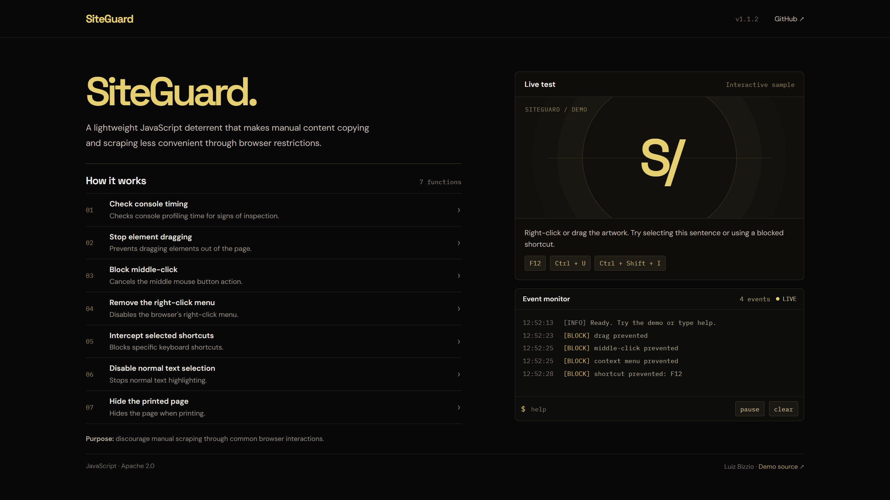

# SiteGuard 🛡️

**Make basic content copying and manual inspection harder with a small JavaScript script.**

[Live Demo](https://siteguard.luizbizzio.com/) · [Source Code](./siteguard.js) · [License](./LICENSE)

<p align="center">
  
</p>

## What is SiteGuard?

SiteGuard is a lightweight, client-side JavaScript tool that limits common browser actions. It is made for website owners who want to discourage casual copying of text, images, and other page content.

It runs directly in the browser. There are no dependencies, accounts, or build tools.

SiteGuard adds friction. It does not make public content private or impossible to copy.

## Features

- **Right-click protection:** Stops the normal browser context menu.
- **Drag protection:** Prevents dragging images and other elements.
- **Middle-click protection:** Cancels actions from the middle mouse button.
- **Keyboard restrictions:** Blocks selected shortcuts, including `F12`, `Ctrl+U`, `Ctrl+P`, `Ctrl+S`, `Ctrl+J`, `Ctrl+F`, and `Ctrl+Shift+I/J/V/C`.
- **Text selection:** Uses CSS rules to disable normal text highlighting.
- **Print protection:** Hides page content when a visitor tries to print it.
- **DevTools timing check:** Measures console profiling time to look for possible browser inspection.

## How it works

SiteGuard uses browser event listeners such as `contextmenu`, `dragstart`, `auxclick`, and `keydown`. When it detects a restricted action, it calls `preventDefault()` to cancel the normal browser behavior.

It also adds CSS rules after the page is loaded. These rules disable text selection and hide the page in print mode.

For its DevTools check, the original script requests a timer every **1 ms** and measures the time taken by `console.profile()` and `console.profileEnd()`. If this takes longer than **10 ms**, the script clears the document and reloads the page.

This is a timing-based guess, not a reliable way to detect DevTools. Browser speed and device performance can affect the result.

## Quick start

This lightweight, minified version is recommended for most cases. It applies the same browser-level deterrents in a smaller form.

```html
<script>
/*!-----------------------------------------------------------------------------
 * SiteGuard - Version 1.1.2
 * Author: Luiz Bizzio
 * License: Apache License Version 2.0
 * Repository: https://github.com/luizbizzio/siteguard
 * Published: 2024-11-08
 * -------------------------------------------------------------------------- */
function af(){var e=!1;setInterval(function(){var t=performance.now();console.profile(),console.profileEnd(),console.clear&&console.clear(),10<performance.now()-t&&!e&&(e=!0,document.documentElement.innerHTML="",location.reload())},1)}af(),document.addEventListener("dragstart",e=>e.preventDefault()),document.addEventListener("auxclick",e=>{1===e.button&&(e.stopPropagation(),e.preventDefault())}),document.addEventListener("contextmenu",function(e){e.preventDefault()}),document.onkeydown=e=>{[{ctrl:!0,shift:!0,code:"KeyI"},{ctrl:!0,shift:!0,code:"KeyJ"},{ctrl:!0,shift:!0,code:"KeyV"},{ctrl:!0,shift:!0,code:"KeyC"},{ctrl:!0,code:"KeyU"},{ctrl:!0,code:"KeyP"},{ctrl:!0,code:"KeyS"},{ctrl:!0,code:"KeyJ"},{ctrl:!0,code:"KeyF"},{code:"F12"}].some(t=>!!t.ctrl===e.ctrlKey&&!!t.shift===e.shiftKey&&e.code===t.code)&&e.preventDefault()},document.addEventListener("DOMContentLoaded",function(){document.body.style.setProperty("user-select","none","important");const e=document.createElement("style");e.type="text/css",e.media="print",e.innerHTML="* { display: none !important; }",document.head.appendChild(e);const t=document.createElement("style");t.type="text/css",t.innerHTML="body {-webkit-touch-callout: none; -webkit-user-select: none; -khtml-user-select: none; -moz-user-select: none; -ms-user-select: none; user-select: none;}",document.head.appendChild(t)});
</script>
```

> [!WARNING]
> Place the SiteGuard script at the beginning of the `<head>` section, right after `<meta charset="UTF-8">` and before any other JavaScript.

## Live demo

**[Try SiteGuard](https://siteguard.luizbizzio.com/)**

The demo lets you test the restrictions yourself, see blocked events in a live monitor, and read an explanation of each part of the original script.

The demo uses a **250 ms** timing interval and shows a warning instead of reloading the page. This keeps the demo usable while you test it.

## Before using it

SiteGuard is designed to stop **simple manual actions**, not automated scraping or determined users. It cannot protect content that has already been sent to a visitor's browser.

Some restrictions can also affect normal users. They may block useful shortcuts, printing, text selection, or accessibility features. The frequent timing check may affect performance, and false positives may cause page reloads.

**Test the script on your website and in the browsers you support before using it in production.** For real content protection, use server-side access controls.

## License

SiteGuard is released under the [Apache License 2.0](./LICENSE).

Created by [Luiz Bizzio](https://github.com/luizbizzio).
